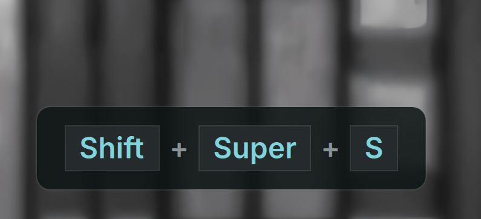

# Screenkey

An always-on-top keystroke and mouse click visualizer for DankMaterialShell (DMS), suitable for screencasts, tutorials, and presentations.



## Install

Use the DMS CLI:
```bash
dms plugins install screenkey
```

Or manually:
```bash
git clone https://github.com/hthienloc/dms-plugins ~/.config/DankMaterialShell/plugins/screenkey
```

## Requirements

- **DankMaterialShell** `>= 1.5.0`
- `evtest` - For monitoring specific keyboard events.
- `libinput` **CLI** - For **"All Keyboards"** mode.
- **Input group** - User must be in the `input` group: `sudo usermod -aG input $USER`.

> [!NOTE]
> On many distros, the libinput CLI is in a separate package: `libinput-tools` (Arch/Debian/Ubuntu) or `libinput-utils` (Fedora). Logout and back in after adding your user to the input group.

## Features

- **Floating Overlay** - Elegant, always-on-top keystroke and mouse click visualizer.
- **Visual Keycaps** - Renders key combinations (e.g., `Ctrl + Shift + A`) as styled keycaps.
- **Mouse Click Indicators** - Shows mouse clicks (left/right/middle) inside a vector-drawn mouse shape.
- **Privacy Mode** - Default option to only show keyboard shortcuts and hide standard letter typing.

## Usage

### Control Center Widget
Toggle the visualizer from the DMS Control Center:
- **Click widget** - Toggle the visualizer overlay on/off.
- **Click settings icon** - Open the Screenkey settings page.

### IPC Commands
Control the visualizer daemon via terminal:
```bash
# Toggle the visualizer
dms ipc screenkey toggle

# Enable the visualizer
dms ipc screenkey enable

# Disable the visualizer
dms ipc screenkey disable
```

## TODO / Roadmap

- [x] **Always-on-top Overlay** - Wayland layer-shell floating overlay.
- [x] **Dynamic Device Scanner** - Scans active keyboards automatically via helper script.
- [x] **Vector Mouse Indicators** - Custom QML-drawn mouse with highlighted left, middle, and right buttons.
- [x] **Multi-line History** - Display a history of the last few shortcuts on screen.
- [x] **Custom Styling** - Custom colors, border radius, custom connector separator, and macOS symbols.
- [x] **Keycap Styles** - Multiple aesthetic styles (Default, Laptop, Low Profile, PBT, Minimal).
- [x] **Held Modifiers Status Bar** - Displays held modifier keys in real-time.
- [ ] **Click Ripple Animation** - Render a visual wave/ripple effect at the cursor coordinates.

## Credits & Acknowledgements

- Keycap styles (Laptop, Low Profile, PBT, Minimal) and icon system ported in collaboration with [@Tz-slayer](https://github.com/Tz-slayer) from [keystrokes](https://github.com/Tz-slayer/keystrokes).
- Original visual design and keycap styling inspired by [@mulaRahul](https://github.com/mulaRahul)'s [keyviz](https://github.com/mulaRahul/keyviz).

## License

MIT

